# 软件与系统安全实验报告

## 实验 1A：嗅探器的设计与实现

| 项目 | 内容 |
| :--- | :--- |
| 姓名 | 李卓 |
| 学号 | 202628016029023 |
| Git 仓库 | [https://github.com/RoyaYe1sLZ/lab1a-sniffer](https://github.com/RoyaYe1sLZ/lab1a-sniffer) |
| 文档日期 | 2026 年 11 月 17 日 |
| 对照代码版本 | `e27a7c7`，2026 年 11 月 12 日 |

<div style="page-break-after: always;"></div>

## 摘要

本实验实现了一个面向 macOS 的图形化网络嗅探器，使用 Python ctypes 调用 libpcap 获取数据，自行解析 Ethernet、IPv4/IPv6、TCP、UDP、ICMP/ICMPv6 及明文 HTTP/1.x。系统支持 BPF 抓包过滤、协议显示过滤、字段与原始字节对应展示，以及经典 PCAP 文件读写；在此基础上，实现双向 TCP 流追踪和本机进程快照关联。

系统以统一数据模型连接实时与离线分析，采用后台采集、有界队列和批量界面更新管理资源。当前代码通过 181 项自动测试，并结合原生 GUI 验收记录与实际网站样本核对功能。本文重点说明捕获、解析和连接分析的实现，以及测试结果和适用边界。

**关键词：** 网络嗅探器；libpcap；协议解析；BPF；TCP 流追踪；进程关联；PySide6

## 目录

- [第一章 实验目的与需求分析](#chapter-1)
- [第二章 实验环境与基础原理](#chapter-2)
- [第三章 系统总体设计](#chapter-3)
- [第四章 核心功能设计与实现](#chapter-4)
- [第五章 加分项：TCP 流追踪与进程关联](#chapter-5)
- [第六章 功能测试与结果分析](#chapter-6)
- [第七章 遇到的问题、解决方法与局限](#chapter-7)
- [第八章 实验总结、运行说明与参考资料](#chapter-8)

<div style="page-break-after: always;"></div>

<div id="chapter-1" style="width: 0; height: 0;"></div>

## 第一章 实验目的与需求分析

### 1.1 实验目的

本实验通过实现带 GUI 的网络嗅探器，学习系统抓包接口、协议分层解析与网络行为分析。重点包括抓包位置与分析层次的区别、libpcap 调用、字节序和长度检查、两类过滤机制，以及 TCP 连接和进程套接字的关联。

### 1.2 课件要求与实现范围

根据课程课件，实验 1A 应实现带 GUI 的网络嗅探器，其中 NPS 数据包嗅探是基础要求，NPA 协议分析需要尽量完善；软件应能筛选 HTTP、TCP/UDP、IPv4/IPv6、ICMP 等不同层次的报文。课件将基于 IP 与端口的 TCP 流追踪，以及某进程产生的 TCP 流分析列为加分方向。[1]

表 1-1 给出需求与本项目功能的对应关系。文件操作和资源管理属于为提高使用完整性而补充的工程功能。

<p style="text-align: center; font-size: 12px; page-break-after: avoid;">表 1-1　实验要求与功能对应关系</p>

| 类别 | 需求或设计目标 | 对应实现 |
| :--- | :--- | :--- |
| 基础要求 | 实际捕获网络接口上的数据包 | 枚举接口、选择接口、开始与停止抓包，保留时间戳和原始字节 |
| 图形交互 | 使用 GUI 浏览和分析 | 数据包列表、协议树、字节视图、状态信息与交互提示 |
| 协议分析 | 解释不同层次的协议 | Ethernet、VLAN、IPv4、IPv6、TCP、UDP、ICMP/ICMPv6、明文 HTTP/1.x |
| 过滤能力 | 按协议或条件筛选报文 | libpcap BPF 抓包过滤，以及按已解析协议层进行的显示过滤 |
| 加分项 | 基于 IP 与端口的 TCP 流 | 双向连接归组、观测状态、方向统计、时序列表与原始包定位 |
| 加分项 | 某进程产生的 TCP 流 | 套接字快照与连接匹配、进程选择及已关联多流过滤 |
| 补充功能 | 保存和离线查看 | 微秒精度经典 PCAP 2.4 导入、全量导出和共用解析入口 |
| 补充功能 | 长时间操作时资源有界 | 有界队列、包数与缓存预算、连接索引上限、异步退出清理 |

### 1.3 技术路线选择

项目采用 Python 3.13、PySide6 Qt Widgets 和系统 libpcap，通过 ctypes 连接 Python 与 C 接口。libpcap 负责捕获与 BPF，独立的 Python 解析器负责解释原始字节，Qt 负责展示。协议解析自行实现，不依赖 Scapy、dpkt 等解析库；命令行入口用于诊断接口和捕获行为。

<div style="page-break-before: always;"></div>

<div id="chapter-2" style="width: 0; height: 0;"></div>

## 第二章 实验环境与基础原理

### 2.1 实验环境

表 2-1 为本机虚拟环境中的实际配置；依赖由 `pyproject.toml` 声明、`uv.lock` 锁定。

<p style="text-align: center; font-size: 12px; page-break-after: avoid;">表 2-1　实验环境</p>

| 项目 | 配置 |
| :--- | :--- |
| 操作系统 | macOS 26.6，arm64 |
| Python | 3.13.17 |
| Qt Python 绑定 | PySide6-Essentials 6.12.0 |
| 绑定运行组件 | shiboken6 6.12.0 |
| 抓包库 | 系统 libpcap 1.10.1 |
| 自动测试工具 | pytest 9.2.0 |
| 主要观察接口 | `en0` 物理接口、`lo0` 回环接口；虚拟隧道接口按实际路由选择 |
| 本机抓包条件 | 需要具备相应 `/dev/bpf*` 设备的访问权限 |

### 2.2 OSI 模型、协议封装与分析层次

OSI 七层模型依次为物理层、数据链路层、网络层、传输层、会话层、表示层和应用层。以 Ethernet 上的 HTTP 为例，报文按 Ethernet、IP、TCP、HTTP 封装；解析时依据类型和头长逐层定位。

<p style="text-align: center; font-size: 12px; page-break-after: avoid;">表 2-2　协议层次与分析内容</p>

| 本项目观察层次 | 典型内容 | 分析关注点 |
| :--- | :--- | :--- |
| 数据链路层或接口伪头 | Ethernet、VLAN、NULL/LOOP | MAC、EtherType、地址族、网络层起点 |
| 网络层 | IPv4、IPv6、ICMP/ICMPv6 | IP 地址、长度、下一协议、分片、控制消息类型与代码 |
| 传输层 | TCP、UDP | 端口、Seq/Ack、标志、长度 |
| 应用层 | 可见的明文 HTTP/1.x | 请求行、状态行和头字段 |

抓包位置决定哪些字节可见，分析能力决定能解释到哪一层。例如，获得承载 HTTPS 的 TCP 包不等于能够解密其应用内容；回环接口还可能提供系统伪头，需要按链路类型确定 IP 起点。

### 2.3 libpcap 与系统抓包

libpcap 提供统一的数据包捕获接口，使上层程序可以枚举设备、打开接口、设置过滤条件、读取数据、查询统计并关闭句柄。[2] 在 macOS 上，实时抓包需要通过系统提供的 BPF 抓包机制访问所选接口。

本项目的主要调用顺序为：

```text
pcap_findalldevs → 显示可用接口

pcap_create
    → 设置 snaplen、缓冲区、立即模式等选项
    → pcap_activate
    → pcap_compile / pcap_setfilter（设置了过滤条件时）
    → pcap_setnonblock
    → pcap_datalink
    → 循环 pcap_next_ex
    → pcap_stats
    → pcap_close
```

### 2.4 BPF 抓包过滤与显示过滤

BPF 抓包过滤表达式由 libpcap 编译和安装，决定哪些数据包会被交给程序。表达式支持协议、地址、端口及逻辑组合。[3] 本项目采用两类不同的过滤方式：

<p style="text-align: center; font-size: 12px; page-break-after: avoid;">表 2-3　抓包过滤与显示过滤对比</p>

| 项目 | BPF 抓包过滤 | 协议显示过滤 |
| :--- | :--- | :--- |
| 执行位置 | libpcap 抓包路径 | GUI 的代理模型 |
| 设置时机 | 开始本次抓包前 | 抓包中、停止后或离线查看时 |
| 对缓存的影响 | 未通过的包不进入本次缓存 | 保留全部数据，仅改变可见行 |
| 条件示例 | `tcp and port 443`、`udp`、`ip6` | HTTP、TCP、UDP、IPv4、IPv6、ICMP |
| 对保存的影响 | 保存已经实际捕获的数据 | 导出仍包含全部缓存包 |

### 2.5 字节序、字段偏移与边界检查

网络协议中的多字节整数通常使用大端序，Python `struct` 的 `!H` 表示网络字节序的 16 位无符号整数。IPv4 IHL 和 TCP Data Offset 均以 4 字节为单位决定实际头长。[5][7] 解析必须同时受捕获长度与上层声明长度约束，具体边界检查见第 4.3.1 节。

### 2.6 TCP 连接与进程套接字

TCP 连接由双方 IP 和端口标识，双向包需归入同一连接。建连时结合 SYN、SYN+ACK、ACK 的标志与 Seq/Ack 判断，SYN 和 FIN 均占用序列号空间。[7] 进程通过套接字持有连接，而普通捕获帧不携带 PID，因此需从系统套接字快照补充进程线索。

<div style="page-break-before: always;"></div>

<div id="chapter-3" style="width: 0; height: 0;"></div>

## 第三章 系统总体设计

### 3.1 模块划分

系统按数据获取、解析、存储和展示划分职责，表 3-1 中代码均位于 `src/lab1a_sniffer/`。

<p style="text-align: center; font-size: 12px; page-break-after: avoid;">表 3-1　程序模块划分</p>

| 模块 | 主要代码位置 | 职责 |
| :--- | :--- | :--- |
| 程序入口 | `__main__.py`、`cli.py` | 解析命令，启动 GUI 或诊断功能 |
| C 接口声明 | `_ffi.py` | 加载 libpcap，声明 C 结构体与函数签名 |
| 捕获与文件底层 | `pcap.py` | 网卡枚举、实时/离线句柄、BPF、PCAP 写入 |
| 抓包会话 | `capture.py` | 后台线程、有界队列、停止事件与状态 |
| 数据模型 | `models.py` | 原始包、协议层、字段和解析问题等值对象 |
| 协议解析 | `parser.py`、`formatting.py` | 按字节解析，组织摘要及原始字节展示 |
| GUI 调度与模型 | `gui_controller.py`、`gui_models.py` | 定时取包、批量解析、源模型与过滤代理 |
| 文件任务 | `storage.py`、`gui_files.py` | 缓存预算、后台读取、保存与结果交接 |
| TCP 流 | `flows.py`、`gui_flows.py` | 连接索引、状态、方向时序及定位 |
| 进程关联 | `processes.py`、`gui_processes.py` | 系统快照、进程身份与异步采样 |
| 界面与主题 | `gui.py`、`gui_theme.py`、`gui_widgets.py` | 主窗口、交互、统一样式和组件 |

`tests/`、`scripts/`、`samples/` 和 `docs/` 分别保存自动测试、GUI 验收脚本、协议样本与设计说明。

<div style="page-break-before: always;"></div>

### 3.2 线程与主要数据流

系统由抓包线程、GUI 主线程、文件线程和进程采样任务组成，跨线程交接原始记录、解析结果或快照，分工见图 3-1。

<div style="page-break-inside: avoid; break-inside: avoid; text-align: center;">
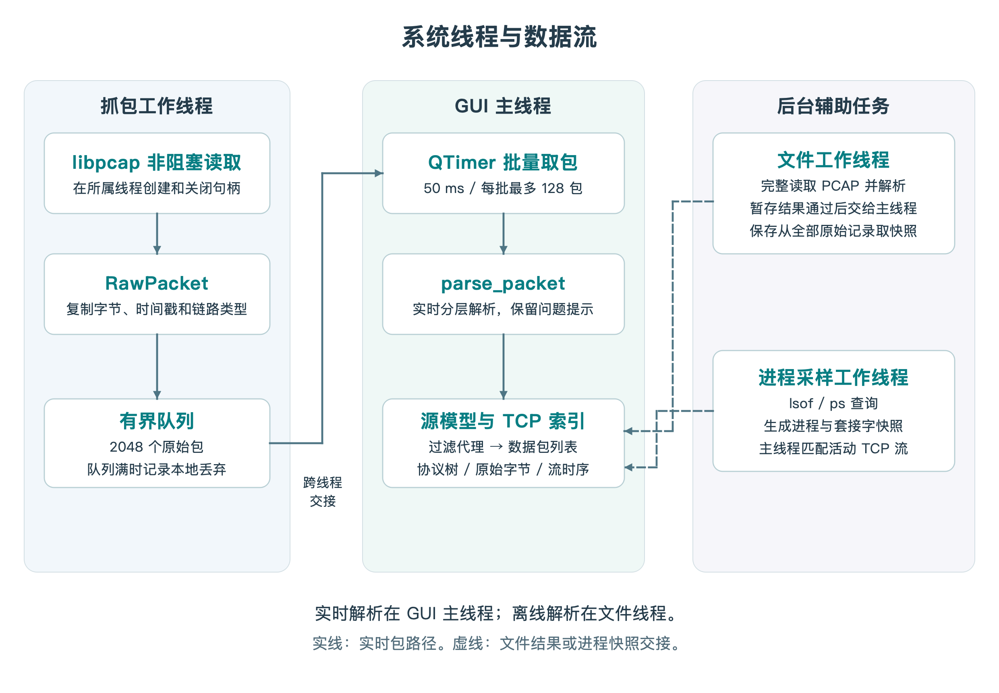
<p style="font-size: 12px; margin-top: 6px;">图 3-1 系统线程与数据流。虚线表示离线结果或进程快照交接，实线表示实时数据路径。</p>
</div>

`CaptureController` 每 50 ms 最多取出 128 个原始包，在 GUI 主线程解析并批量更新模型，使事件循环能继续响应输入和重绘。离线文件则在文件线程完成解析，成功后一次性交接。

### 3.3 数据模型与统一解析入口

`RawPacket` 保存用于解析和导出的原始记录，核心字段如下：

```python
@dataclass(frozen=True, slots=True)
class RawPacket:
    seconds: int
    microseconds: int
    wire_length: int
    linktype: int
    data: bytes
```

捕获长度由 `len(data)` 得出，整数秒与微秒避免浮点时间戳精度损失，`bytes` 保证数据不可变。`ParsedPacket` 引用该记录，保存协议层、端点、摘要和问题；`PacketField` 记录字段偏移与长度，用于字节高亮。实时与离线数据统一调用 `parse_packet(raw)`。

<div style="page-break-before: always;"></div>

### 3.4 会话状态与资源管理

每次抓包创建独立 `CaptureSession`，状态包括空闲、启动中、抓包中和停止中。停止后继续接收已入队数据，确认队列清空且线程结束后回到空闲。

队列默认最多保存 2048 个原始包，满时计入本地丢弃。GUI 最多缓存 20000 个包，解析对象保守预算为 128 MiB；达到缓存上限时停止抓包并提示。该预算不等于整个进程 RSS。

TCP 索引最多保存 2048 条流、20000 个包行号，每流最多 4 个进程线索。索引只引用行号，超限时提示未跟踪数量，原始包仍可浏览。

<div id="chapter-4" style="width: 0; height: 0;"></div>

## 第四章 核心功能设计与实现

本章界面截图分别拍摄于 2026 年 11 月 12 日和 17 日，日期见图注。本地 HTTP、UDP、ping 和进程关联使用主动产生的测试流量；显示过滤和文件往返对比使用五包人工样本 `samples/protocols.pcap`。不同轮次的测试结果在第六章分别说明。

### 4.1 ctypes 与 libpcap 封装

#### 4.1.1 C 函数与结构体声明

`_ffi.py` 使用 ctypes 声明结构体及函数的 `argtypes`、`restype`。[4] 布局需与平台 ABI 一致：64 位 macOS 的 `timeval` 秒字段为 C `long`、微秒字段为 32 位整数，并保留自然对齐，避免字段错位：

```python
class Timeval(C.Structure):
    _fields_ = [("tv_sec", C.c_long), ("tv_usec", C.c_int32)]


class PacketHeader(C.Structure):
    _fields_ = [
        ("ts", Timeval),
        ("caplen", C.c_uint32),
        ("len", C.c_uint32),
    ]
```

#### 4.1.2 网卡枚举与初始化

`list_interfaces()` 遍历 libpcap 接口链表，生成名称、描述和标志对象，最后释放链表。`LiveCapture` 设置单包截取长度、2 MiB 缓冲区、立即模式和非阻塞读取，默认不启用混杂模式。激活失败时反馈具体错误；激活成功后读取链路类型并存入后续包记录。

### 4.2 实时读取、停止与统计

`pcap_next_ex()` 返回包头和数据指针。底层在检查长度和指针合法性后，立即将数据复制为 Python `bytes`：

```python
return RawPacket(
    value.ts.tv_sec,
    value.ts.tv_usec,
    value.len,
    self.info.linktype,
    C.string_at(data, value.caplen) if value.caplen else b"",
)
```

该步骤避免 libpcap 内部缓冲区在下一次读取时发生变化，影响已经排队的数据。包头中的 `caplen` 表示本次取得的字节数，`len` 表示线上长度；合法的截断捕获可能满足 `caplen < len`。

抓包线程先尝试读取已有数据，暂时无包时再等待可读事件；单次等待不超过约 50 ms，因而不依赖新流量到达才能响应停止。抓包句柄由创建它的线程独占，其他线程通过事件提出停止请求，不直接关闭该句柄。

状态记录读取、入队及队列丢弃数量，并单独查询 `pcap_stats`。本地队列丢弃与平台提供的内核丢包统计分别展示。

图 4-1 展示 11 月 17 日在 `lo0` 上的实时抓包。通过本地 HTTP、IPv4/IPv6 UDP 和 ping 获得 20 个包；列表、协议树、原始字节区与顶部统计同时更新，物理接口的补充结果见图 6-1。

<div style="page-break-inside: avoid; break-inside: avoid; text-align: center;">
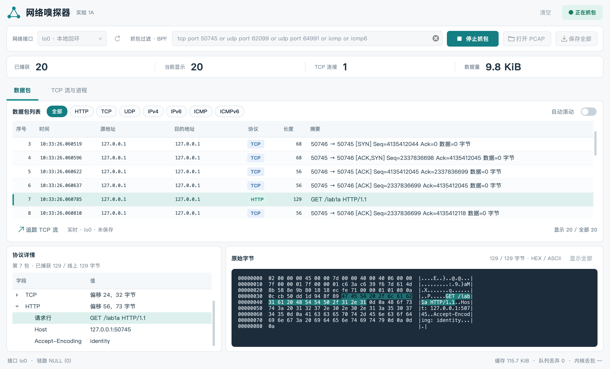
<p style="font-size: 12px; margin-top: 6px;">图 4-1　回环接口实时抓包及分层查看（2026 年 11 月 17 日）。</p>
</div>

### 4.3 分层协议解析

#### 4.3.1 解析入口与错误表达

`parse_packet()` 为统一入口，内部 `_Parser` 根据链路类型定位网络层，再分派到 IPv4/IPv6 和相应上层协议。所有字段偏移都相对于 `RawPacket.data`。

解析器通过 `need()` 统一检查边界：

```python
def need(self, offset, length, end, context, declared_end=None):
    if declared_end is not None and offset + length > declared_end:
        self.stop("malformed", f"{context} 所需长度超出上层声明的边界", offset)
    if offset + length > end:
        self.stop("truncated", f"{context} 被截断，需要 {length} 字节", offset)
```

`end` 为可见边界，`declared_end` 为上层声明范围。超界后通过 `ParseIssue` 记录原因并停止继续解析，保留已确认的层和原始数据。

#### 4.3.2 Ethernet、VLAN 与回环链路

Ethernet 解析先检查 14 字节固定头部，再读取目的 MAC、源 MAC 和 EtherType。遇到受支持的 VLAN 类型时，逐层读取 4 字节标签，记录 VLAN ID、优先级与后续类型；最多处理 4 层，避免无限嵌套。

EtherType 为 IPv4/IPv6 时继续分派；未知类型保留链路层信息，因此此类包的地址可能显示为 MAC。

系统同时处理 `DLT_NULL`、`DLT_LOOP` 和原始 IP 类型。NULL 地址族字段按本机字节序解释，LOOP 按网络字节序解释；原始 IP 从版本字段直接确定网络层。具体入口由记录的链路类型决定。

图 4-2 展示物理接口 UDP 包的链路层和网络层字段。EtherType 为 `0x0800`，对应右侧的 IPv4；界面也保留了各层在原始字节中的起始位置。

<div style="page-break-inside: avoid; break-inside: avoid; text-align: center;">
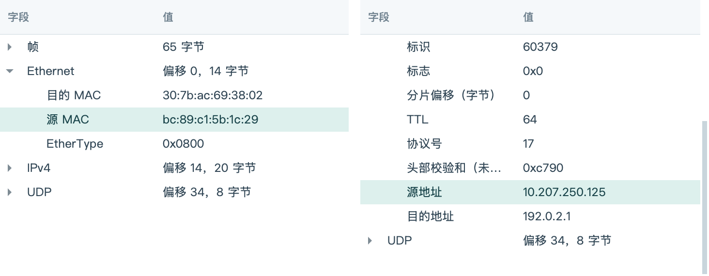
<p style="font-size: 12px; margin-top: 6px;">图 4-2　左为 Ethernet 字段，右为 IPv4 字段（2026 年 11 月 17 日）。</p>
</div>

#### 4.3.3 IPv4 与 IPv6

IPv4 解析提取地址、长度、分片及协议等字段，IHL 的计算和合法性检查如下：

```python
header = (first & 15) * 4
if first >> 4 != 4 or header < 20 or total < header:
    self.stop("malformed", "IPv4 版本、IHL 或总长度不合法", offset)
```

上层解析范围取实际捕获末尾与 IPv4 总长度末尾中的较小者，避免将 Ethernet 填充解释成 TCP 载荷。发现需要重组的 IPv4 分片时，仅展示已确认的 IP 信息，不继续分析传输层。

IPv6 先检查 40 字节固定头部，再解析地址、载荷长度、下一头部等字段。[6] 对 Hop-by-Hop、Routing、Destination 等扩展头逐层推进，最多 8 层；需要重组的分片、ESP 及未支持的扩展情况停止上层解析并提示。

图 4-3 为 IPv6 回环 UDP 报文：源、目的地址均为 `::1`，下一头部为 17，继续进入 UDP 解析。两端端口均为 64991，来自向本机同一套接字发送并接收的数据报。

<div style="page-break-inside: avoid; break-inside: avoid; text-align: center;">
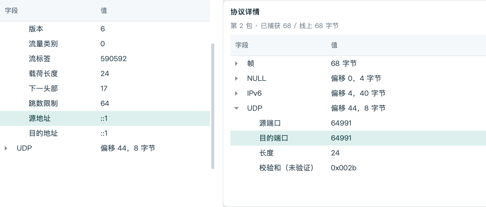
<p style="font-size: 12px; margin-top: 6px;">图 4-3　IPv6 地址与对应的 UDP 端口字段（2026 年 11 月 17 日）。</p>
</div>

#### 4.3.4 TCP、UDP、ICMP 与 ICMPv6

TCP 解析读取端口、Seq、Ack、Data Offset、标志、窗口、校验和及紧急指针，根据头长确定载荷起点。标志使用按位判断，可同时展示 SYN、ACK、FIN、RST、PSH、URG、ECE 与 CWR，避免将多标志组合错误地识别为单一值。

UDP 解析读取 8 字节头部，校验 UDP 长度不小于 8 且不超出 IP 声明范围。ICMP 和 ICMPv6 展示类型、代码、校验和，并进一步解释可识别的 Echo 标识符和序号。遇到无法进一步解释的消息类型时，仍保留基础字段与原始内容。

图 4-4 来自 IPv4 和 IPv6 的本机 ping，分别显示类型 8 和 128、代码 0，对应两种 Echo Request。校验和栏展示报文原值，未作有效性验证。

<div style="page-break-inside: avoid; break-inside: avoid; text-align: center;">
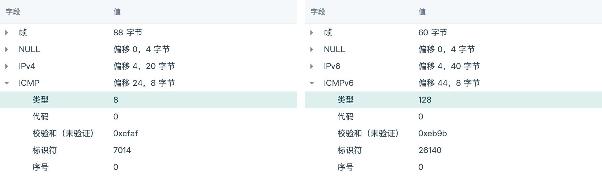
<p style="font-size: 12px; margin-top: 6px;">图 4-4　左为 ICMP，右为 ICMPv6（2026 年 11 月 17 日）。</p>
</div>

#### 4.3.5 明文 HTTP/1.x

HTTP 解析匹配 TCP 载荷中的请求行或状态行，按 CRLF 读取完整头字段。[8] 识别依据是内容，适用于非标准端口；具体请求与响应样本见第 6.3 节。

解析范围最多为 16 KiB，最多保留 128 个头字段。载荷未满足请求行或状态行匹配规则时，不标记为 HTTP；起始行可以识别但头部结束标志尚未完整可见时，保留可确认内容并提示不完整。跨 TCP 段的内容不会被拼接，消息体也不进行完整的 HTTP 消息语义重建。

图 4-5 展示本地 HTTP 的实际请求和响应。上图选中了 `Host`，右侧对应字节被高亮；下图可见 `HTTP/1.0 200 OK` 和 `Content-Length: 8580`。该长度为响应头中的声明，不表示程序已经重组了全部响应内容。

<div style="page-break-inside: avoid; break-inside: avoid; text-align: center;">
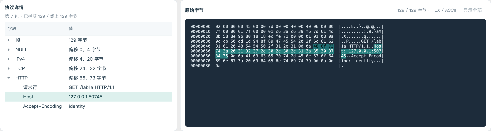
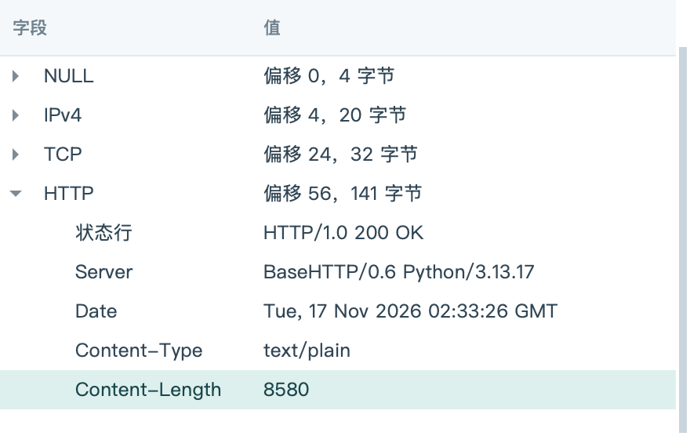
<p style="font-size: 12px; margin-top: 6px;">图 4-5　HTTP 请求字段高亮与响应头解析（2026 年 11 月 17 日）。</p>
</div>

### 4.4 图形界面与字段定位

GUI 采用 Qt Widgets，以数据包和 TCP 流两页组织工作区。全局工具栏提供接口选择、BPF 输入、抓包启停、PCAP 打开与全量保存。统计条显示捕获数量、当前可见数量、全部缓存中的 TCP 连接数量和原始包字节量。

数据包页分为列表、协议字段树和原始字节区。列表包含序号、时间、源地址、目的地址、协议、长度和摘要。选中一行后，主窗口从源模型取得对应 `ParsedPacket`，生成协议树并展示十六进制及 ASCII。字段自带偏移和长度，点击后可高亮相应字节。字节区默认限制初始展示长度，并提供展开能力。

<div style="page-break-inside: avoid; break-inside: avoid; text-align: center;">
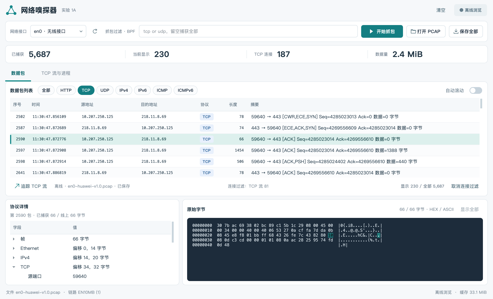
<p style="font-size: 12px; margin-top: 6px;">图 4-6 数据包、协议字段与字节高亮界面（2026 年 11 月 12 日）。</p>
</div>

主题和复用组件分别集中在 `gui_theme.py`、`gui_widgets.py`；使用等宽地址字体、协议配色和可拖动分隔条提高可读性。

### 4.5 显示过滤与源数据一致性

`PacketTableModel` 保存全部包，`ProtocolFilterModel` 筛选可见行。[9][10] 协议判断遍历所有已解析层，因此 HTTP 包也能匹配其 TCP 和 IP 层；连接条件与协议条件共同生效。

选择事件通过 `mapToSource()` 定位原始包，隐藏当前行时更新或清空详情。导出直接读取源模型，确保过滤不会遗漏待保存数据。

图 4-7 对同一份五包人工样本分别选择 HTTP 和 TCP，两次都显示两个 HTTP 包；“显示 2 / 全部 5”说明其余数据仍在缓存中，也说明 HTTP 可以按下层 TCP 协议匹配。

<div style="page-break-inside: avoid; break-inside: avoid; text-align: center;">
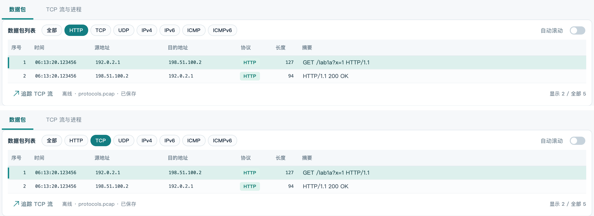
<p style="font-size: 12px; margin-top: 6px;">图 4-7　上为 HTTP 显示过滤，下为 TCP 显示过滤（2026 年 11 月 17 日）。</p>
</div>

<div style="page-break-before: always;"></div>

### 4.6 PCAP 文件导入与导出

#### 4.6.1 文件格式与离线解析

当前读写范围为单一链路类型、微秒时间戳的经典 PCAP 2.4，明确拒绝 PCAPNG、纳秒时间戳等未支持输入。离线读取首先检查全局头与每条记录，确认版本、时间戳、截取长度和数据范围，再与 libpcap 读取结果核对。

文件线程将记录转换为 `RawPacket` 并解析，完整成功且未超预算后才替换模型；取消或出错保留旧数据。导入时旧缓存和暂存结果可能同时占用内存。

跨字节序的 DLT_NULL 文件会将四字节地址族伪头规范为本机字节序，IP 内容不变。因此，同平台导出再读取可以保持原始字节一致；跨平台回环伪头的字节不承诺与源文件完全相同。

#### 4.6.2 全量保存与目标文件保护

保存前停止实时抓包，并从源模型获取不可变原始记录的快照。底层通过 libpcap 写入经典 PCAP，让库处理运行时 DLT 与文件 LINKTYPE 的映射，而不是直接将平台 DLT 数值当作文件编号。

保存先写入同目录临时文件，完整写入、刷新并关闭后，通过 `os.replace()` 替换目标；失败或取消则清理临时文件，保留原目标。

文件任务在后台执行。读取过程中关闭窗口会请求取消并等待回收；保存过程中关闭则等待保存结束。未保存数据在被清空或替换前提示用户，显示过滤本身不改变保存状态。

图 4-8 上图在 HTTP 筛选下执行“保存全部”，当前可见 2 包、缓存 5 包；下图重新打开同一导出文件并选择“全部”，仍能显示原有 5 包。该操作验证了显示过滤不会改变文件导出的范围。

<div style="page-break-inside: avoid; break-inside: avoid; text-align: center;">
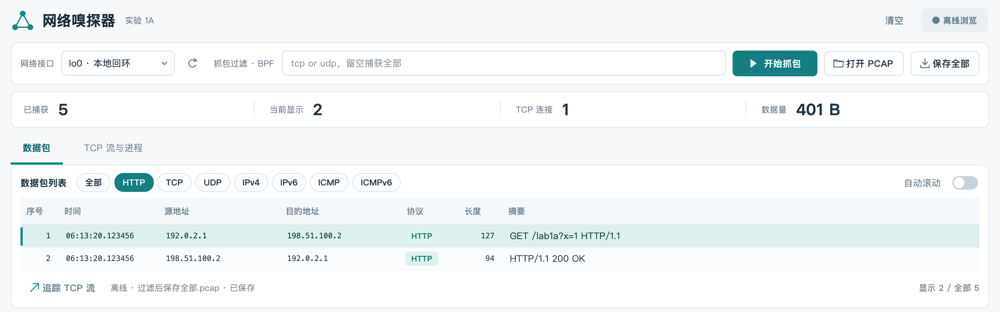
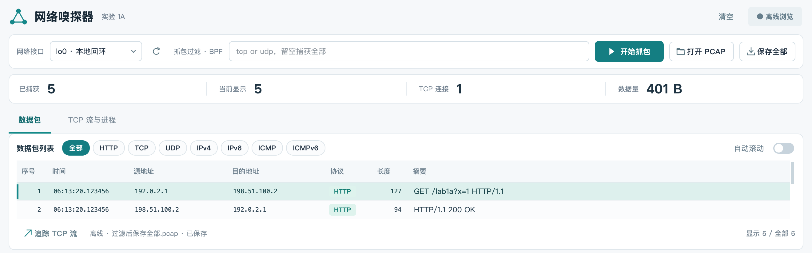
<p style="font-size: 12px; margin-top: 6px;">图 4-8　筛选后全量保存及重新打开（2026 年 11 月 17 日）。</p>
</div>

<div style="page-break-before: always;"></div>

<div id="chapter-5" style="width: 0; height: 0;"></div>

## 第五章 加分项：TCP 流追踪与进程关联

### 5.1 双向 TCP 连接索引

`flows.py` 从 TCP 层读取端点、Seq、Ack、标志及载荷长度，以 `ipaddress` 规范化地址，并将两个端点排序形成无方向连接键：

```python
def connection_key(a, b):
    return tuple(sorted((a, b)))
```

该键负责寻找同一对端点，流对象另行保留 A、B 方向。若观察到初始 SYN，以发送端为 A；若首包为 SYN+ACK，可推定相对端为发起端；中途开始捕获时，以首包发送端为 A，并显示“中途捕获”。

同一四元组可能被后续连接复用。相同初始 SYN 的重传不会重复建立流；出现不同初始序列号的新 SYN，或连接已结束后出现新 SYN，会建立新的流代次。没有捕获到新握手时，程序不能保证识别所有复用情况。

### 5.2 握手与关闭的观测状态

连接状态由实际捕获的报文更新。三次握手不仅要求观察到 SYN 和 ACK 标志，还要核对序列号与确认号是否对应。对于普通不携带数据的握手，若 A 初始序列号为 x，B 为 y，主要关系见图 5-1。[7]

<div style="page-break-inside: avoid; break-inside: avoid; text-align: center;">
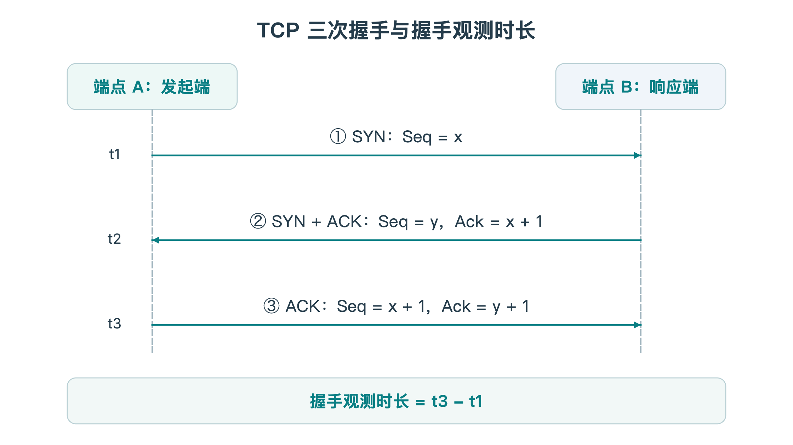
<p style="font-size: 12px; margin-top: 6px;">图 5-1 无数据 SYN 的三次握手示意。程序还处理 SYN 携带数据和序列号回绕。</p>
</div>

观察到对应握手后才显示“已见三次握手”，并计算首次 SYN 到最终 ACK 的捕获时间差。

关闭判断区分单向 FIN、双向 FIN 得到确认和 RST。单个 FIN 显示“关闭中”，观察到双方 FIN 及其确认后显示“FIN 已确认”，出现 RST 则显示“RST 结束”。这些状态概括抓包中的线索，不等同于操作系统完整 TCP 状态机。

### 5.3 方向统计、时序与原包跳转

每条流保存源模型行号及 A→B、B→A 两个方向的包数、线上帧字节和捕获 TCP 载荷长度。相对时间以该流首次观测时间为基准，时序行包含原包序号、方向、TCP 标志、Seq、Ack 和载荷长度。

<div style="page-break-inside: avoid; break-inside: avoid; text-align: center;">
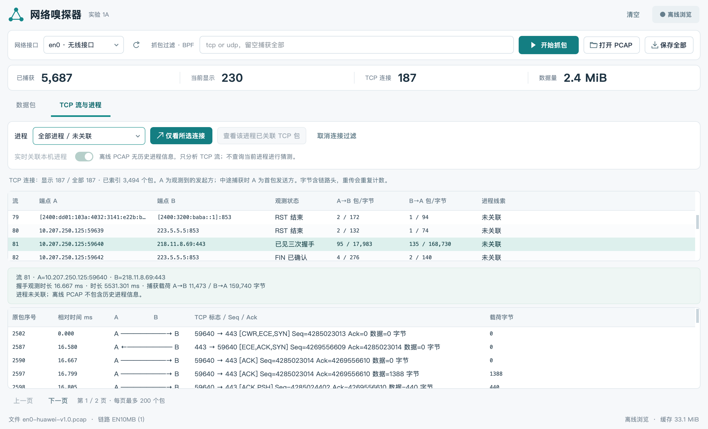
<p style="font-size: 12px; margin-top: 6px;">图 5-2 流 81 的连接统计与方向时序（2026 年 11 月 12 日）。</p>
</div>

用户可以从数据包页追踪所选包所在连接，也可以在流页双击时序行返回原始包。连接过滤后列表仍保留源序号，便于将时序、协议字段和字节对应起来。时序每页最多展示 200 行，限制单次控件创建量。

图 5-3 补充展示“仅看所选连接”的结果：列表只保留选中 TCP 流的双向报文，底部标明连接过滤条件，并提供取消入口。

<div style="page-break-inside: avoid; break-inside: avoid; text-align: center;">
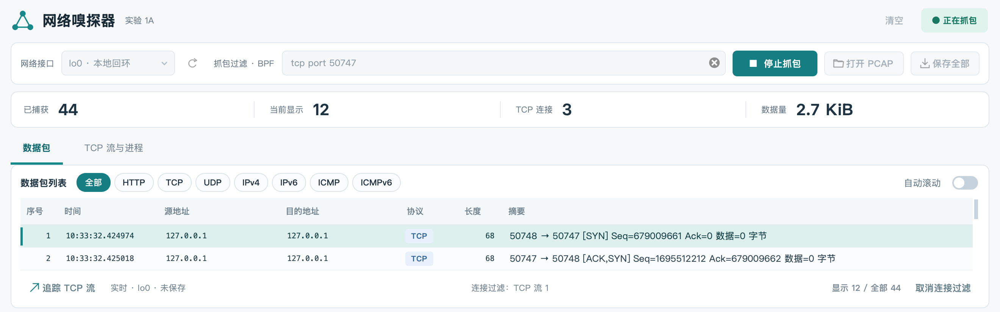
<p style="font-size: 12px; margin-top: 6px;">图 5-3　按选中的 TCP 连接筛选原始报文（2026 年 11 月 17 日）。</p>
</div>

统计中的线上帧字节包含包头，捕获载荷只计算可见的 TCP 数据；重传仍作为观察到的独立包重复计数。因此这些数字不代表去重后的应用数据量。系统建立的是包归组与时序索引，没有进一步重建连续、去重的 TCP 字节流。

### 5.4 进程套接字采样与身份核对

`processes.py` 使用 `lsof` 字段输出采集当前用户可见的 TCP 套接字。[11] 核心命令形式如下：

```bash
/usr/sbin/lsof -w -nP +c 0 -a -u 当前用户UID -iTCP -Fpcn
```

其中 UID 在代码中由 `os.getuid()` 获得。解析器只接受同时具有本地和对端地址的连接记录，使用完整端点匹配，不依据监听端口推测连接归属。回环连接中客户端与服务端都可能持有对应套接字，因此一条流可以保留多个进程线索。

采样前后使用 `ps` 核对 PID 对应的启动时间，并以 PID、名称和启动时间组成进程身份，降低扫描期间 PID 被新进程复用的混淆。快照包含开始与结束时间，只与时间接近的活动流匹配，已经结束的流不新增关联。

`ProcessController` 在没有查询任务运行时，约每秒发起一次异步采样；单次查询耗时会延后后续采样，同一时刻只保留一个任务。系统命令支持取消和 2 秒超时；输出读取后检查 2 MiB 上限，并限制套接字和进程记录数量。查询失败时反馈原因，抓包和解析仍可继续。

### 5.5 按进程查看已关联 TCP 流

实时采样得到的进程身份记录到流对象，界面下拉框展示本轮已经成功关联的进程。选择进程后，连接列表筛选其已关联流；“查看该进程已关联 TCP 包”进一步将这些流作为包列表的过滤范围。

图 5-4 为 11 月 17 日补充的本机测试：同一客户端进程 PID 26106 建立两条连接，另一进程建立第三条对照连接。选择该 PID 后显示“2 / 全部 3”条流；进一步查看该进程已关联的 TCP 包，只显示上述两条连接中的报文。进程下拉框中的条目来自成功匹配的流，并非系统的全部进程列表。

<div style="page-break-inside: avoid; break-inside: avoid; text-align: center;">
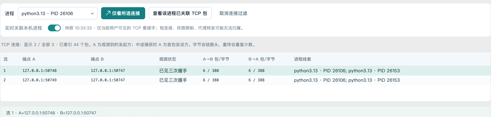

<p style="font-size: 12px; margin-top: 6px;">图 5-4　同一进程的多条 TCP 流及对应报文筛选（2026 年 11 月 17 日）。</p>
</div>

未匹配时显示“未关联”。停止后保留已有线索，不再采样；经典 PCAP 不保存进程信息，离线只重建连接，不查询当前进程推测历史归属。

<div style="page-break-before: always;"></div>

<div id="chapter-6" style="width: 0; height: 0;"></div>

## 第六章 功能测试与结果分析

### 6.1 测试环境、方法与版本

测试采用自动回归、原生 GUI 验收、tcpdump 交叉核对和网站样本分析。环境见第 2.1 节，对照代码为 `e27a7c7`。2026 年 11 月 16 日执行：

```bash
.venv/bin/python -m pytest -q --run-live --physical-interface en0
```

结果为 **181 passed in 8.08s**，无失败或跳过，包括 en0/lo0 实际捕获。常规 Qt 控件测试使用 offscreen 平台；Cocoa 交互结果引用 11 月 12 日原生回归记录，以下分别说明。

11 月 16 日的测试日志、结构化复核结果和 tcpdump 输出随源码保存在 `docs/实验报告/assets/evidence/`，记录提交版本、计数及历史证据来源。

11 月 17 日的原生界面操作检查共 39 项，全部通过，对应记录为 `screenshots-2026-11-17.json`。同日自动回归仍为 181 项通过，耗时 7.99 s；日志为 `pytest-2026-11-17.txt`。这两份记录与上述历史结果分开保存，以下各项按日期注明来源。

### 6.2 物理接口与回环接口实时抓包测试

回环测试产生本地 HTTP、IPv4/IPv6 UDP 和 ping 流量；物理接口测试发送带标记的 UDP。表 6-1 列出阶段二保存的包数与字段结果，11 月 16 日同类实际捕获回归也通过。

<p style="text-align: center; font-size: 12px; page-break-after: avoid;">表 6-1　阶段二真实抓包历史记录</p>

| 场景 | 链路类型 | 历史记录的捕获结果 | 字段与状态检查 |
| :--- | :--- | :--- | :--- |
| lo0 上的 HTTP 与 UDP | NULL，DLT=0 | 16 包：最高识别层 HTTP 2、TCP 12、UDP 2 | 请求/响应、IPv4/IPv6 UDP 标记与端口正确，解析问题数为 0 |
| en0 出站 UDP | EN10MB，DLT=1 | 3 个 Ethernet/IPv4/UDP 包 | 出站标记、源/目的地址与端口正确，解析问题数为 0 |
| lo0 上的 IPv4/IPv6 ping | NULL，DLT=0 | 4 包：ICMP 2、ICMPv6 2 | Echo 请求与响应被识别，解析问题数为 0 |

三组记录的队列及内核报告丢包均为 0，停止无错误。TCP 结束过程可能导致总包数变化，验收依据为标记、字段和资源释放。

图 6-1 是 11 月 17 日补拍的 `en0` 抓包，三个 UDP 包均已进入列表。测试目标 `192.0.2.1` 仅用于产生出站流量，截图不表示目标已收到或回复；同日回环抓包的 20 个包见图 4-1，与表 6-1 中阶段二的历史轮次分开记录。

<div style="page-break-inside: avoid; break-inside: avoid; text-align: center;">
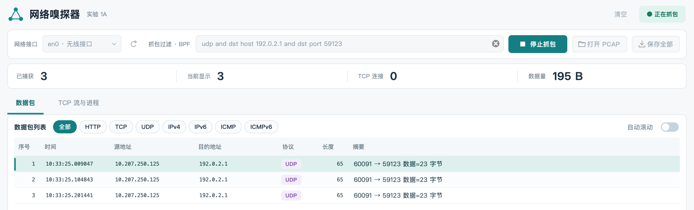
<p style="font-size: 12px; margin-top: 6px;">图 6-1　物理接口捕获三个主动产生的 UDP 包（2026 年 11 月 17 日）。</p>
</div>

<div style="page-break-before: always;"></div>

### 6.3 协议解析正确性与 tcpdump 交叉核对

使用 `samples/protocols.pcap` 的五个人工独立报文核对字段；其中 HTTP 包不构成完整 TCP 会话。

<p style="text-align: center; font-size: 12px; page-break-after: avoid;">表 6-2　固定报文字段核对</p>

| 样本 | 关键字段 | 程序识别结果 |
| :--- | :--- | :--- |
| IPv4/TCP HTTP 请求 | `192.0.2.1:12345 → 198.51.100.2:8080`，`GET /lab1a?x=1 HTTP/1.1` | HTTP，并保留 TCP/IPv4 下层关系 |
| IPv4/TCP HTTP 响应 | `198.51.100.2:8080 → 192.0.2.1:12345`，`HTTP/1.1 200 OK` | HTTP，响应状态行与可见头字段正确 |
| IPv6/UDP | `[2001:db8::1]:12345 → [2001:db8::2]:54321` | UDP，IPv6 地址及端口正确 |
| IPv4/ICMP Echo | 标识符 4660，序号 7 | ICMP Echo Request |
| IPv6/ICMPv6 Echo | 标识符 4660，序号 9 | ICMPv6 Echo Request |

独立核对命令为：

```bash
/usr/sbin/tcpdump -nn -S -vv -r samples/protocols.pcap
```

所列字段与 tcpdump 相符：请求样本 Seq=16909060、Ack=84281096，IPv4 TTL=64，IPv6 Hop Limit=32，完整输出见配套证据目录中的 `tcpdump-protocols.txt`。

边界测试覆盖可变头部、VLAN、回环/原始 IP、IPv6 扩展头、填充、分片和不完整 HTTP。对固定样本的全部截断前缀检查层、字段和问题位置是否在有效范围内；另用 1500 组确定性随机输入检查解析器不会抛出未处理异常。

HTTP 请求样本使用 8080 端口仍被识别；测试中的非 HTTP 文本载荷放在 80 端口也未被误识别。结果与按可见报文内容识别 HTTP 的设计一致。

### 6.4 BPF 抓包过滤与协议显示过滤测试

**抓包过滤。** 实时测试覆盖端口及协议组合条件、非法表达式报错和失败后重新启动。另用 tcpdump 离线筛选五包样本，核对 BPF 语义；这项辅助检查不属于程序的离线 BPF 功能。

<p style="text-align: center; font-size: 12px; page-break-after: avoid;">表 6-3　BPF 表达式筛选结果</p>

| BPF 表达式 | 通过包数 |
| :--- | :--- |
| `tcp` | 2 |
| `udp` | 1 |
| `ip` | 3 |
| `ip6` | 2 |
| `icmp` / `icmp6` | 1 / 1 |
| `tcp or udp` | 3 |
| `(tcp or udp) and ip` | 2 |
| `tcp and (` | 编译失败，返回语法错误 |

图 6-2 上图使用 `udp port 62099`，只收集本次向该端口发送的两个 UDP 数据报；下图输入无效的 `tcp and (` 后提示语法错误，原有两个包仍然保留。

<div style="page-break-inside: avoid; break-inside: avoid; text-align: center;">

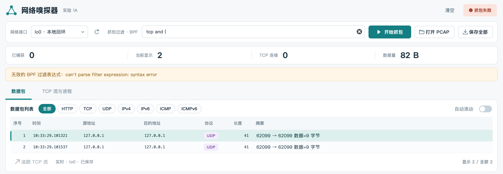
<p style="font-size: 12px; margin-top: 6px;">图 6-2　有效 BPF 端口过滤与无效表达式提示（2026 年 11 月 17 日）。</p>
</div>

**显示过滤。** 原生验收对同一样本切换协议，源缓存始终为 5 包：

<p style="text-align: center; font-size: 12px; page-break-after: avoid;">表 6-4　协议显示过滤结果</p>

| 显示条件 | 可见数量 |
| :--- | :--- |
| 全部 | 5 |
| HTTP | 2 |
| TCP | 2 |
| UDP | 1 |
| IPv4 | 3 |
| IPv6 | 2 |
| ICMP | 1 |
| ICMPv6 | 1 |

HTTP 与 TCP 均显示两个包，符合封装关系。UDP 可见行正确定位原始第 3 包；隐藏选择后详情更新，零条可见时缓存仍保留。

<div style="page-break-before: always;"></div>

### 6.5 PCAP 文件往返与异常输入测试

文件往返比较包数、整数时间戳、捕获/线上长度、链路类型和原始字节，结果如下。

<p style="text-align: center; font-size: 12px; page-break-after: avoid;">表 6-5　文件往返与异常输入结果</p>

| 测试场景 | 检查结果 |
| :--- | :--- |
| HTTP 过滤后保存五包样本 | 导出仍含全部 5 包，时间戳、长度和字节一致，tcpdump 可读回 |
| 一个包被显示条件全部隐藏后保存 | 零条可见行仍可导出缓存中的该包 |
| 空 PCAP、中文与空格路径 | 可按设计打开或保存，不将有效空文件误判为失败 |
| 大小端文件头与多种受支持链路类型 | 正确解析；跨字节序 NULL 伪头按约定规范化 |
| 截断记录、非法时间戳或长度 | 拒绝损坏文件，保留之前的模型 |
| PCAPNG、纳秒精度或不支持的格式 | 明确报错，不进行隐式有损转换 |
| 读取取消、超过缓存预算或读取中文件变化 | 不提交暂存结果，旧列表保持可用 |
| 保存失败或取消 | 清理临时文件，保留已有目标文件 |

自动回归及历史原生文件验收的 22 项检查通过。原生脚本使用受控路径替代系统文件选择器，未自动操作 macOS 文件面板。

11 月 17 日补充的文件界面操作同样预先指定路径，实际读写仍由文件任务完成。图 6-3 展示损坏文件被拒绝后，界面提示“PCAP 数据包内容被截断”，原有 5 个包继续保留。

<div style="page-break-inside: avoid; break-inside: avoid; text-align: center;">
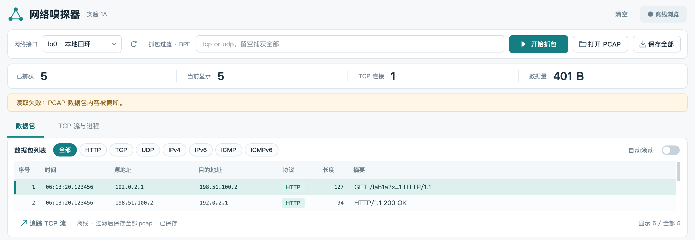
<p style="font-size: 12px; margin-top: 6px;">图 6-3　打开损坏 PCAP 时保留原有数据（2026 年 11 月 17 日）。</p>
</div>

<div style="page-break-before: always;"></div>

### 6.6 TCP 流追踪与进程关联测试

11 月 16 日的算法回归覆盖双向归组、重传、端口复用、中途捕获、错误或不完整握手、ECN、序列号回绕、带数据 SYN、FIN/RST，以及计数和容量限制。

11 月 12 日原生验收使用独立服务端，同一客户端进程建立两条连接，另一进程建立第三条对照连接。18 项检查全部通过，主要结果如下。

<p style="text-align: center; font-size: 12px; page-break-after: avoid;">表 6-6　TCP 流与进程关联结果</p>

| 验证目标 | 原生记录的结果 |
| :--- | :--- |
| 连接归组 | 识别三条不同的 TCP 流，均观察到相应握手 |
| 进程区分 | 同一客户端两条流关联到同一进程，对照客户端被区分 |
| 时序与关闭 | 展示双向时序和握手观测时长，观察到正常关闭过程 |
| 原包定位 | 双击时序行定位源模型中的原始包 |
| 按进程筛选 | 只显示所选进程已关联流中的包 |
| 保存和离线重建 | 过滤后仍全量保存，离线重建连接，不猜测历史 PID |
| 退出清理 | 未遗留相应工作线程 |

### 6.7 启停、退出与持续运行稳定性测试

11 月 16 日的生命周期回归包含十次空闲启停；历史原生 GUI 的 14 项检查涵盖真实抓包、字段高亮、反复启停、抓包中关闭和线程回收，均通过。

基础版本另有原生 Cocoa 五分钟记录：在 `lo0` 上以约 20 包/秒交替产生 IPv4/IPv6 UDP，采样 RSS 和界面心跳，结束后核对 PCAP 往返。

<p style="text-align: center; font-size: 12px; page-break-after: avoid;">表 6-7　基础版本五分钟稳定性记录</p>

| 指标 | 历史记录 |
| :--- | :--- |
| 实际持续时间 | 300.261 s |
| 产生 / 捕获包数 | 6000 / 6000 |
| 捕获原始字节 | 636000 B |
| 本地队列丢弃 | 0 |
| 内核报告丢包 / 接口丢包 | 0 / 0 |
| 最大观测心跳间隔 | 66.218 ms |
| 末次解析对象预算估算 | 25595489 B，约 24.41 MiB |
| 末次采样 RSS | 222412800 B，约 212.1 MiB |
| PCAP 往返与线程回收 | 检查通过 |

该结果针对加分项和 UI 改版前的基础版本；当前版本尚未重跑五分钟，也未完成高速压力测试。RSS 为离散采样，不能作为严格峰值或无泄漏证明。

<div style="page-break-before: always;"></div>

### 6.8 华为官网访问抓包综合分析

#### 6.8.1 样本概况与连接选择

`en0-huawei-v1.0.pcap` 于 2026 年 11 月 12 日 11:30:41.344932 至 11:30:54.789426（北京时间）捕获，跨度 13.444494 s。对该文件的离线复核得到 5687 包，其中 TCP 3494、UDP 2148。全部 TCP 包进入索引，形成 187 条观测流，无索引容量丢弃。文件还包含其他后台通信。

选择图 5-2 中的流 81：

<p style="text-align: center; font-size: 12px; page-break-after: avoid;">表 6-8　网站样本流 81 统计</p>

| 项目 | 本次样本结果 |
| :--- | :--- |
| 端点 A | `10.207.250.125:59640` |
| 端点 B | `218.11.8.69:443` |
| 总包数 | 230 |
| A→B / B→A 包数 | 95 / 135 |
| A→B / B→A 线上帧字节 | 17983 / 168730 B |
| A→B / B→A 捕获 TCP 载荷 | 11473 / 159740 B |
| 握手观测时长 | 16.667 ms |
| 首末包观测跨度 | 5531.301 ms |

#### 6.8.2 三次握手核对

<p style="text-align: center; font-size: 12px; page-break-after: avoid;">表 6-9　流 81 的三次握手字段</p>

| 原包序号 | 相对时间 / ms | 方向 | TCP 标志 | Seq / Ack |
| :--- | ---: | :--- | :--- | :--- |
| 2502 | 0.000 | A→B | SYN、ECE、CWR | 4285023013 / 0 |
| 2587 | 16.580 | B→A | SYN、ACK、ECE | 4269556609 / 4285023014 |
| 2590 | 16.667 | A→B | ACK | 4285023014 / 4269556610 |

第二、三次握手的 Ack 分别为对端初始 Seq 加 1，符合握手关系；SYN 同时带有 ECE/CWR，也能通过按位判断识别。

SYN 时间为 11:30:47.856109，最终 ACK 为 11:30:47.872776，差值 16.667 ms，与界面及配套 `tcpdump-huawei-flow.txt` 的输出相符。

#### 6.8.3 数据传输与域名确认

握手后，第 2597 包从 A 向 B 发送 1388 B TCP 载荷，第 2598 包紧接着发送 440 B。前者 Seq 为 4285023014，后者为 4285024402，恰好相差 1388；第 2642 包的 Ack 为 4285024842，等于起始序列号加上 1388 与 440。由此可以将方向时序与 TCP 累计确认联系起来。

域名确认使用独立辅助脚本：按 Seq 有界组合这两段载荷，在 ClientHello 的 `server_name` 中读取到 **`www.huawei.com`**。[12] 11 月 17 日再次核对同一文件得到相同结果，记录为配套的 `huawei-sni-check-2026-11-17.json`。 这项复核不属于嗅探器内置的 TLS 解析或流重组，GUI 中相应包仍显示为 TCP。

统计载荷含重传，不能等同于页面大小；5531.301 ms 仅为该流观测跨度，不能作为整页加载时间或已关闭连接的证明。

<div style="page-break-before: always;"></div>

<div id="chapter-7" style="width: 0; height: 0;"></div>

## 第七章 遇到的问题、解决方法与局限

### 7.1 Python 包运行入口与相对导入问题

在 PyCharm 中直接运行 `src/lab1a_sniffer/__main__.py` 时，曾出现：

```text
ImportError: attempted relative import with no known parent package
```

入口中的 `from .cli import main` 依赖包上下文，直接执行文件无法确定相对导入的父包。解决方法为按模块启动：PyCharm 设置模块名 `lab1a_sniffer`、参数 `gui`、解释器 `.venv`、工作目录为项目根目录；终端命令见第 8.2 节。

### 7.2 BPF 域名过滤无数据与接口、代理路由选择

`host www.huawei.com` 在编译时将域名转换为地址条件，不搜索 HTTP Host/TLS SNI，也不自动覆盖全部资源域名。浏览器复用连接、IPv4/IPv6 或 CDN 地址差异，都可能使目标通信未被该条件捕获。表达式中的点无需写成 `\.`。

启用 TUN 代理后，目标通信可能先经过 `utun`，物理接口上则是代理转发后的端点；`utun6` 等编号由系统分配。排查顺序为：

1. 清除显示和连接过滤，区分“未捕获”与“已捕获但隐藏”。
2. 对域名解析出的目标 IP 使用 `route -n get` 查看 `interface`，结合代理配置选择接口。
3. 从较宽条件开始，在抓包启动后重新产生流量，再按实际地址、端口和协议收窄条件。

### 7.3 进程关联不完整的原因与观察方法

进程列表曾只出现 QQ 的部分条目。该列表仅展示本轮已匹配的套接字持有者，主要影响因素如下。

<p style="text-align: center; font-size: 12px; page-break-after: avoid;">表 7-1　进程关联的影响因素</p>

| 原因 | 对关联结果的影响 |
| :--- | :--- |
| 约一秒的周期采样 | 很短的连接可能在两次查询之间结束 |
| 接口、代理或地址映射 | 出口端点可能与应用套接字不一致，或只能关联代理进程 |
| 当前用户与系统权限范围 | 其他用户或受限进程不一定可见 |
| 停止采集或离线 PCAP | 不再获得新的实时快照，文件也不含历史 PID |

观察目标进程时，应先开启实时关联，再产生持续或重复 TCP 通信，并核对接口和完整端点。离线或未选中有效进程时，查看已关联包的按钮禁用；未匹配到时保留未知，不能推断为没有所属进程。

### 7.4 HTTPS 数据可见范围与应用层解析限制

官网连接经过 TLS 加密，因此可见 TCP 包未必匹配 HTTP 筛选。当前程序不能读取其请求路径、响应头或正文；第 6.8 节辅助确认的 SNI 表示客户端请求的服务器名称，不能单独证明远端 IP 的所有权，也不是完整 URL。明文 HTTP 的单包解析范围见第 4.3.5 节。

<div style="page-break-before: always;"></div>

### 7.5 当前实现的其他局限与后续改进方向

<p style="text-align: center; font-size: 12px; page-break-after: avoid;">表 7-2　现有局限与改进方向</p>

| 局限及影响 | 后续改进方向 |
| :--- | :--- |
| 无 TCP/IP 重组，跨段与分片内容不完整 | 增加有界缓存、乱序、重传和超时处理 |
| 未解析 DNS、TLS、HTTP/2、QUIC 等内容 | 按需扩展协议，并建立对应样本 |
| 校验和仅展示，尚未验证 | 增加验证，考虑截断与系统卸载的影响 |
| 缺包或未见 SYN 时，流代次与状态可能不完整 | 完善异常时序判断和不确定性表达 |
| PCAP 不保存进程快照 | 增加带采样时间和进程身份的独立会话元数据 |
| 仅支持经典微秒 PCAP | 扩展 PCAPNG、多接口与时间精度支持 |
| GUI 主线程解析，且仅适配 macOS | 测量瓶颈后考虑后台解析、滚动缓存与平台适配 |

<div id="chapter-8" style="width: 0; height: 0;"></div>

## 第八章 实验总结、运行说明与参考资料

### 8.1 实验总结

本项目完成了图形化捕获、分层解析、过滤与文件操作，并实现 TCP 流追踪和进程关联加分项。实验将原始字节、协议字段、连接时序与系统套接字联系起来，说明协议分析需兼顾长度边界与观测完整性，工程实现则需明确线程职责和资源生命周期。

### 8.2 源码与运行方式

源码与完整提交记录见封面 Git 链接。在 64 位 macOS 安装 uv 后，可以克隆仓库、创建环境并启动。仓库处于私有状态时，需要已获授权的 GitHub 账号；所有代码应开源并保留完整记录，课件允许提交后再将仓库设置为 public。[1]

```bash
git clone https://github.com/RoyaYe1sLZ/lab1a-sniffer.git
cd lab1a-sniffer
uv sync --locked
.venv/bin/python -m lab1a_sniffer gui
```

本机已有虚拟环境，启动时应先进入项目根目录：

```bash
cd "/Users/roya/Desktop/security project"
.venv/bin/python -m lab1a_sniffer gui
```

应通过模块入口启动，避免直接运行包内的 `__main__.py`。实时抓包需要 BPF 设备访问权限，离线查看 `samples/protocols.pcap` 不需要该权限。

<div style="page-break-before: always;"></div>

### 8.3 参考资料

以下资料用于核对抓包接口、协议格式及 GUI 模型设计；外部资料查阅与复核日期为 2026 年 11 月 16—17 日。

1. 《实验 1 讲解 2026》，软件与系统安全课程课件，第 2～3、5、9、14～15 页。
2. The Tcpdump Group. [libpcap 1.10.1：pcap 手册](https://github.com/the-tcpdump-group/libpcap/blob/libpcap-1.10.1/pcap.3pcap.in).
3. The Tcpdump Group. [libpcap 1.10.1：pcap-filter 过滤表达式手册](https://github.com/the-tcpdump-group/libpcap/blob/libpcap-1.10.1/pcap-filter.manmisc.in).
4. Python Software Foundation. [Python 3.13：ctypes 文档](https://docs.python.org/3.13/library/ctypes.html).
5. IETF. [RFC 791：Internet Protocol](https://www.rfc-editor.org/rfc/rfc791.html).
6. IETF. [RFC 8200：Internet Protocol, Version 6 (IPv6) Specification](https://www.rfc-editor.org/rfc/rfc8200.html).
7. IETF. [RFC 9293：Transmission Control Protocol (TCP)](https://www.rfc-editor.org/rfc/rfc9293.html).
8. IETF. [RFC 9112：HTTP/1.1](https://www.rfc-editor.org/rfc/rfc9112.html).
9. Qt Group. [Qt for Python：QAbstractTableModel](https://doc.qt.io/qtforpython-6/PySide6/QtCore/QAbstractTableModel.html).
10. Qt Group. [Qt for Python：QSortFilterProxyModel](https://doc.qt.io/qtforpython-6/PySide6/QtCore/QSortFilterProxyModel.html).
11. lsof Project. [lsof 官方手册](https://lsof.readthedocs.io/en/latest/manpage/).
12. IETF. [RFC 6066：TLS Extensions，Server Name Indication](https://www.rfc-editor.org/rfc/rfc6066.html).
